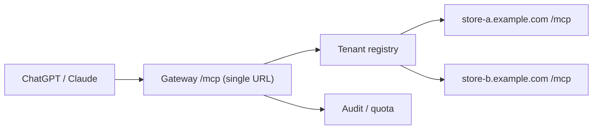

# ChatGPT プラグイン登録計画（ChatGPT / Claude コネクター等）

本プラグインが提供する MCP サーバー（`POST /mcp`）を、ChatGPT のプラグイン（旧コネクター / 旧 Apps SDK）および Claude のコネクターとして登録・公開するための計画。

- ステータス: **計画（コード変更は未着手）**
- 対象バージョン: 1.1.3（`Service/McpHttpService.php` の `SERVER_VERSION`）
- 調査根拠: 本リポジトリ最終更新時点で公開されていた OpenAI / Anthropic の開発者ドキュメント（末尾「参考」）。両社とも名称・要件の変更が速いため、着手時に再確認する。

---

## 1. 要旨

1. **登録先は「ChatGPT Plugin」（MCP ベース）が本命**。2023 年の旧 ChatGPT Plugins は廃止済みで、現在の「プラグイン」は MCP サーバー（＋任意のスキル・UI）を束ねた配布単位。MCP サーバーは既に実装済みなので、土台は揃っている。
2. **最大の障害は技術ではなくテナント構成**。公開ディレクトリへの登録は「全ユーザー共通の単一 MCP URL」が原則で、店舗ごとにドメインが異なる EC-CUBE プラグインの配布形態とは噛み合わない。テナント別 URL の「Template 登録」は OpenAI との信頼関係がある開発者に限られる。
3. そのため **Phase 1（店舗ごとセルフ接続＝審査不要・今日から可能）→ Phase 2（ホスト型ゲートウェイで単一 URL 化）→ Phase 3（ディレクトリ申請）** の段階移行を推奨する。
4. Phase 0 のうちメタデータ（`title` / `annotations`）、プロトコルバージョン交渉、説明文の事実化、内部列の除去は**実装済み**。残るは認証と注文系（第 7 章）、および審査提出の運用準備。

---

## 2. 現状（実装済みの事実）

| 項目 | 現状 | 参照 |
| --- | --- | --- |
| エンドポイント | `POST /mcp`（Streamable HTTP, JSON 応答）、`GET /.well-known/mcp.json`（独自 Discovery）、`GET /.well-known/mcp`（エイリアス） | `Resource/config/routes.yaml`, `Controller/McpHttpController.php` |
| トランスポート | Streamable HTTP。`GET /mcp` は 405（SSE 不提供を明示）。batch 非対応 | `Controller/McpHttpController.php` |
| プロトコル | クライアント要求の `protocolVersion` を交渉して返す（2025-11-25 / 2025-06-18 / 2025-03-26 / 2024-11-05、未指定・未対応時は 2025-06-18） | `Service/McpHttpService.php` |
| ツール | 7 種・すべて読み取り専用: `search_products` / `get_product_detail` / `get_stock` / `get_categories` / `get_category_products` / `get_tags` / `search_by_tag` | `Service/ProductToolDefinition.php`, `Service/ProductToolExecutor.php` |
| メタデータ | `name` / `title` / `description` / `inputSchema` / `annotations` とサーバー `instructions` を返す。`outputSchema` / `structuredContent` は未対応 | `Service/McpHttpService.php`, `Service/ProductToolDefinition.php` |
| 認証 | なし。`Authorization` は受け取るが未検証（write 系追加時の TODO コメントのみ） | `Controller/McpHttpController.php:164` |
| レート制限 | クライアント IP ＋ ツール名単位、120 req/min（`get_stock` は 60）。`cache.app` に PSR-6 保存、read-modify-write で非アトミック | `Service/RateLimitService.php` |
| CORS | `Access-Control-Allow-Origin: *` ＋ `Permissions-Policy: tools=self` | `Controller/McpHttpController.php:262` |
| 監査 | ツール名・結果・所要時間・IP ハッシュを記録（失敗は握りつぶし） | `Service/McpHttpService.php`, `Repository/McpAuditRepository.php` |
| データ範囲 | 商品・カテゴリ・タグ・在庫のみ。**顧客情報・注文情報は返さない** | `Repository/ProductRepository.php` |
| テスト | Unit（`McpHttpServiceTest` / `RateLimitServiceTest`）、HTTP e2e（`e2e/mcp.spec.ts`）、`make verify` / `make test-unit` / `make test-matrix` | `Tests/`, `bin/verify-plugin.sh`, `Makefile` |

現状の動作確認は次の 2 コマンドで足りる（店舗ドメインを置換）。

```bash
curl -s https://shop.example.com/.well-known/mcp.json

curl -s -X POST https://shop.example.com/mcp \
  -H 'Content-Type: application/json' \
  -H 'Accept: application/json, text/event-stream' \
  -d '{"jsonrpc":"2.0","id":1,"method":"tools/list"}'
```

---

## 3. 登録先プラットフォームの比較

名称の変遷が激しいため、まず「どれが今の本命か」を固定する。OpenAI は Apps SDK（2025-10）→ connectors を apps に改称（2025-12）→ アプリディレクトリを plugin ディレクトリへ統合（2026-07）と推移しており、**現在の「プラグイン」＝スキル＋MCP サーバー＋任意 UI の束**である。

| 登録先 | 実体 | 公開範囲 | 審査 | 本件での位置づけ |
| --- | --- | --- | --- | --- |
| ChatGPT プラグイン（ディレクトリ） | MCP サーバー（＋スキル / UI） | 全 ChatGPT ユーザー | あり（組織 verification・ツールスキャン・手動レビュー） | 最終目標 |
| ChatGPT カスタム MCP サーバー | 利用者が設定画面で URL を登録 | 個人 / ワークスペース内 | なし | Phase 1 の提供形態 |
| GPT Actions（OpenAPI） | OpenAPI 3.x スキーマ | その GPT の共有範囲 | なし | 非推奨（MCP と二重実装になる） |
| Claude コネクター（ディレクトリ） | MCP サーバー | 全 Claude ユーザー | あり（`title`＋annotation 必須、読み書き分離） | ChatGPT と並ぶ第 2 の目標 |
| Claude カスタムコネクター | 利用者が URL を登録 | 個人 / 組織内 | なし | Phase 1 で同時に案内可能 |
| その他（Gemini / Copilot 等） | MCP 対応が拡大中 | — | — | **要調査**（第 9 章） |

補足（調査時点の制約）:

- ChatGPT の認証方式は「OAuth」「なし」「OAuth または なし（mixed）」の 3 択。読み取り専用サーバーは「なし」でも接続できる。OAuth では CIMD（Client ID Metadata Document）優先、DCR も可。
- 「なし」を選べるとはいえ、**IP 許可リストは認証の代替にならない**と明記されている。
- EU データレジデンシーのプロジェクトは MCP 付きプラグインを申請できない（グローバルデータレジデンシーのプロジェクトが必要）。
- 公開後は MCP の origin（scheme / host / port）を変更できない。パスの変更のみ新バージョンで可能。

---

## 4. 配信モデルの決定（最重要）

### 4.1 選択肢

| 案 | 内容 | 登録形態 | 審査 | 主なコスト / 制約 |
| --- | --- | --- | --- | --- |
| **A. ホスト型ゲートウェイ** | 当社が単一の MCP URL を運用し、OAuth で識別したテナントを各店舗の `/mcp` へプロキシ | ディレクトリ登録可（単一 URL） | あり | インフラ・SSRF 対策・個人情報保護者としての説明責任・稼働責任 |
| **B. 店舗ごとセルフ接続** | プラグイン同梱の `/mcp` を店舗オーナーが ChatGPT / Claude に手動登録 | カスタム接続のみ | なし | 設定の手間（ドキュメントで吸収）。ディレクトリには載らない |
| **C. Template URL 登録** | `https://{shop_domain}/mcp` 形式でテナント別 URL を登録 | ディレクトリ登録可（条件付き） | あり | **OpenAI との信頼関係がある開発者に限定**。例示 URL は実在の審査用店舗が必要 |
| **D. GPT Actions** | 店舗ごとに OpenAPI スキーマを GPT に登録 | GPT の共有 | なし | 実装二重化・将来性が低い |

### 4.2 推奨

**B →（A または C）の段階移行**を推奨する。理由:

- B は追加インフラゼロで今日から価値が出る。EC-CUBE プラグインの配布形態（各自のドメイン）と矛盾しない。
- A はディレクトリ露出という最大のリターンがある一方、当社が「データ処理者」になる。プライバシーポリシー・稼働責任・審査対応の負荷が跳ね上がるため、B で実利用の証拠（テストプロンプトと期待応答、利用実績）を先に作るのが合理的。
- C は交渉次第で最短ルートになり得る。OpenAI との関係構築が前提なので、A と並行して打診する。

### 4.3 案 A（ゲートウェイ）の設計方針



- **テナント解決**: OAuth の subject（または接続時発行のテナントトークン）→ 店舗 URL。URL は店舗オーナーが管理画面で登録する。
- **SSRF 対策**: `https` 必須、ホスト名の DNS 解決後に private / loopback / link-local（`169.254.169.254` を含む）を拒否、リダイレクト追従なし、タイムアウトとサイズ上限、ストア単位のトークンで `/mcp` を保護。
- **店舗側の受け口**: 現行 `McpHttpController` は無認証なので、ゲートウェイ用の共有シークレット（`X-Store-Token` 等）または OAuth トークン検証を追加する。
- **保護**: 店舗を守るため `tools/list` と Discovery はゲートウェイでキャッシュ（ChatGPT はメタデータを定期スキャンする）。`tools/call` のみ透過。
- **説明責任**: ゲートウェイを挟む＝商品データが当社サーバーを経由する。プライバシーポリシーに明記が必須（OpenAI / Anthropic 双方の審査要件）。

---

## 5. 要件ギャップ（現状 → 必要な対応）

| # | 要件（公開ドキュメント） | 現状 | 対応 | 優先 |
| --- | --- | --- | --- | --- |
| 1 | 全ツールに人間可読な `title` | なし | `ProductToolDefinition` に `title` を追加し、`tools/list` / Discovery 双方へ反映 | 必須 |
| 2 | `annotations`（`readOnlyHint` / `destructiveHint` / `openWorldHint`）が実挙動と一致 | なし | 7 ツールすべて `readOnlyHint: true` / `destructiveHint: false` / `openWorldHint: false`（自店舗 DB の閉じた範囲のみ） | 必須 |
| 3 | 読み取り専用サーバーは無認証でも可 | 無認証 | Phase 1 はそのまま。ただし乱用対策として接続トークン（任意）を用意 | 任意 |
| 4 | protocolVersion の整合 | `2024-11-05` 固定 | `initialize` でクライアント要求値を交渉（対応集合に含まれればそれを、なければ最新対応版を返す）。少なくとも `2025-06-18` / `2025-11-25` を追加 | 必須 |
| 5 | SSE 非提供の明示 | `GET /mcp` 405 | 仕様上許容。追加対応不要 | — |
| 6 | レート制限がクライアント IP 単位 | ChatGPT の egress IP は共有 → 全 ChatGPT ユーザーで 120 req/min を分け合う | トークン / 接続 / テナント単位に変更。IP は補助指標に降格。`get_stock` の 60 も同様 | 必須 |
| 7 | ツール説明は事実記述（挙動指示は prompt-injection パターンとして指摘対象） | `search_products` 等に「相対パスや https://www.example.com は使用しないでください」という指示文 | 事実文へ書き換え（「返却される `url` は店舗の商品詳細ページの絶対 URL」）。動作要件は `instructions` 側へ | 必須 |
| 8 | 不要な内部情報を返さない | `get_product_detail` が `status_id` / `create_date` / `update_date` を返す | MCP 応答から除外（チャット応答側の利用と衝突するため、`ProductRepository` を直接削らず MCP 層で射影） | 推奨 |
| 9 | 構造化出力（`outputSchema` / `structuredContent`） | text に JSON 文字列を埋めるのみ | `structuredContent` を併設。スキーマは既存の戻り値形状から生成 | 推奨 |
| 10 | サーバー `instructions` | なし | 初回 512 文字以内に要点（税抜価格・絶対 URL・在庫の意味） | 推奨 |
| 11 | CORS が `*` | 任意サイトからブラウザ経由でカタログ取得可 | 既定は同一オリジンのみ、管理画面で許可オリジンを追加 | 推奨 |
| 12 | 審査用の実在デモ環境 | なし | 商品データ入りの検証店舗を公開（MFA なしのアカウントでログインできること） | 必須（Phase 3） |
| 13 | 組織 / 事業者 verification、`api.apps.write` 権限 | 未取得 | Phase 3 の前提作業 | 必須（Phase 3） |
| 14 | 単一 MCP URL（または Template URL） | 店舗ごとに異なるドメイン | 第 4 章のモデル選択で解決 | 必須（Phase 3） |

**実装状況**: #1 / #2 / #4 / #7 / #8 は対応済み（§6 Phase 0）。#3（接続トークン）・#6（トークン単位のレート制限）・#9（構造化出力）・#11（CORS）は認証と管理画面の実装時にまとめて対応（§6 の見送り理由）。#12〜#14 は Phase 3 の前提。

---

## 6. フェーズ計画

### Phase 0: プラグイン側の適合（コード変更）

**状況: 一部実施済み。** 第 5 章 #1（`title`）/ #2（`annotations`）/ #4（protocolVersion 交渉）/ #7（説明文の事実化）/ #8（内部列の削除）は対応済み。以下は当初計画に対する実施内容と、見送った項目。

| 作業 | 対象 | 完了条件 |
| --- | --- | --- |
| ツール定義に `title` / `annotations` / `output_schema` を追加 | `Service/ProductToolDefinition.php` | `tools/list` 応答に 3 項目が現れる |
| マッピングの単一化（`tools/list` と Discovery の二重実装を解消） | `Service/McpHttpService.php`（`handleToolsList` / `buildWellKnownPayload`） | 両応答が同一メタデータを返す（差分テストで担保） |
| protocolVersion 交渉と `instructions` | `Service/McpHttpService.php`（`handleInitialize`） | 未知の要求版には最新対応版を返し、サーバーは落ちない |
| `structuredContent` 併設 | `Service/McpHttpService.php`（`handleToolsCall`） | 既存の text 出力は維持（後方互換） |
| MCP 応答からの内部フィールド除外 | `Service/ProductToolExecutor.php` もしくは MCP 専用の射影 | `get_product_detail` に `status_id` / `create_date` / `update_date` が含まれない |
| ツール説明の事実文化 | `Service/ProductToolDefinition.php` | 命令形（「〜してください」）が説明文に残らない |
| レート制限のキー変更 | `Service/RateLimitService.php` | トークン（未提示時のみ IP）単位で計数。既存テスト更新 |
| CORS 許可オリジンの設定化 | `Controller/McpHttpController.php` | 既定で `*` を返さない。同オリジン＋設定値のみ許可 |
| テスト更新 | `Tests/Unit/Service/*Test.php`, `e2e/mcp.spec.ts`, `Tests/Unit/Service/ChatFlowServiceTest.php` | `make verify` / `make test-unit` / `make test-matrix` が緑、e2e は Docker 環境で緑 |

検証は「テストが通る」だけで終わらせず、MCP Inspector で実接続する。

```bash
npx @modelcontextprotocol/inspector
# Transport: Streamable HTTP / URL: https://shop.example.com/mcp
# initialize → tools/list → 7 ツールを代表入力で tools/call
```

#### 実施内容

| ファイル | 変更 |
| --- | --- |
| `Service/ProductToolDefinition.php` | 7 ツールに `title` と共通 `READ_ONLY_ANNOTATIONS`（`readOnlyHint: true` / `destructiveHint: false` / `openWorldHint: false`）を追加。説明文から「〜してください」を削除し事実記述にした |
| `Service/McpHttpService.php` | `SUPPORTED_PROTOCOL_VERSIONS` と交渉メソッド、`SERVER_INSTRUCTIONS` を追加。tools/list と Discovery の二重マッピングを `buildToolCatalog()` に一本化 |
| `Controller/McpHttpController.php` | `initialize` に `params.protocolVersion` を渡す |
| `Repository/ProductRepository.php` | `getDetail()` から `status_id` / `create_date` / `update_date` を取得しない（MCP に内部列を返さない） |
| `Tests/Unit/Service/McpHttpServiceTest.php`, `e2e/mcp.spec.ts` | メタデータ、交渉、カタログの単一性、命令形の不在を検証 |

#### 見送り（理由付き）

| 項目 | 理由 | 再開条件 |
| --- | --- | --- |
| `outputSchema` / `structuredContent` | 戻り値が DB 由来で揺れ、固定スキーマは誤検証を招く。ChatGPT 側では任意項目 | 注文ツール（第 7 章）の戻り値形状を確定する際に併せて設定 |
| レート制限のトークン単位化 | トークン発行元（OAuth）が未実装で、キーにできる識別子が無い | 第 7 章の認証実装と同時 |
| CORS の既定値変更 | 既存のブラウザ連携（WebMCP）を壊す恐れがある | Phase 1 の管理画面で許可オリジン設定を追加する時 |

### Phase 1: 店舗セルフ接続（審査不要）

粗見積り 3〜4 人日（管理画面・ドキュメント・実接続確認）。

- 管理画面に「外部 AI 接続」設定を追加: 公開 ON/OFF（既定 OFF）、接続トークンの発行 / 失効、許可オリジン、直近の監査ログ表示。
- `Documents/CHATGPT_CONNECT.md` を新設し、ChatGPT（プラグイン → カスタム MCP サーバー追加）と Claude（コネクター追加）の手順を記載（**作成済み**）。developer mode の有効化、Plus/Pro は読み取り専用までという制約も明記。
- 完了条件: 実店舗（検証店舗）で「初心者向けの商品を探して」→「一番安いのは？」→「在庫ある？」が ChatGPT 上で通る。

### Phase 2: ホスト型ゲートウェイ（案 A）

粗見積り 15〜25 人日（実装）＋ 運用設計。

- テナント登録フロー、OAuth（CIMD 優先、難しければ静的クライアント ID）、トークン発行、クォータ、監査、障害時の切り分け。
- ストア側の受け口にゲートウェイ用トークン検証を追加（Phase 0 のレート制限変更と接続点）。
- 完了条件: 単一 URL で 2 店舗以上のテナントが別データを返し、片方の障害が他方に波及しない。

### Phase 3: ディレクトリ申請

| 項目 | OpenAI | Anthropic |
| --- | --- | --- |
| 前提 | 事業者 verification、`api.apps.write`、グローバルデータレジデンシーのプロジェクト | 有料プラン（Pro / Max / Ultra / Team / Enterprise） |
| 提出物 | プラグイン名・ロゴ・説明・会社 URL・プライバシーポリシー URL・MCP URL・OAuth 情報・テストプロンプトと期待応答・対応国・ローカライズ | ドキュメント URL・プライバシーポリシー URL・サポート窓口・アイコン・審査用アカウント |
| ツール要件 | スキャン時に `title` / schema / annotations / `_meta` を取得。annotation と実挙動の不一致は否認理由 | `title` と `readOnlyHint` / `destructiveHint` が全ツールに必須。ツール名 64 文字以内。読み取りと書き込みの分離 |
| 注意 | origin は公開後に変更不可。1 バージョンのみ公開・1 バージョンのみ審査中 | — |

完了条件: 公開後、ディレクトリ検索から到達でき、審査用テストプロンプトが期待応答を返す。

### Phase 4: 継続運用

- ツール定義は「バージョン付き API 契約」として扱う。追加は後方互換、改名・削除は新バージョン扱い。
- OpenAI は公開後もツール定義を継続スキャンする。**サーバーを先に壊さない**（審査保留中も旧定義が live のため）。
- 監査ログとレート制限の実測を見て閾値を見直す。

---

## 7. 注文機能（書き込み）の設計

**オーナー判断: 注文まで進める。決済はカード不要、銀行振込など外部リダイレクト無しで完結する手段のみ。**

この判断で最大の障害が 1 つ消える。カード決済は 3D セキュアでブラウザ遷移が必須となり、ChatGPT の会話内で完結できない。振込・代引・店頭払いは注文確定後の案内で完結するため、チャット内で発注まで進められる。

### 7.1 読み取り専用からの差分

現行 7 ツールはすべて `readOnlyHint: true`。注文系を追加すると次が必要になる。

| 領域 | 必要なもの |
| --- | --- |
| 認証 | OAuth 2.1（MCP 認可仕様）。会員の識別。Resource Metadata、AS Metadata、PKCE `S256`、`resource` の引き回し |
| クライアント登録 | CIMD 優先、DCR も可。静的クライアントで済ませるならその登録 |
| 同意 | ツール単位の `securitySchemes`（`oauth2` + scope）。未認証時は 401 + `WWW-Authenticate`、ツールレベルでは `_meta["mcp/www_authenticate"]` |
| アカウント識別 | `get_profile` 相当（`_meta["openai/profile"]: true`）。複数アカウント接続時の識別に使う |
| ツール分割 | 読み取り（履歴照会）と書き込み（カート投入・注文確定）を別ツールにする。読み書き混在は審査で否認対象 |
| 安全 | `destructiveHint: true`（注文確定は取消不能）、実行前の確認、冪等キー |
| 決済 | 振込・代引など offline 決済のみ。外部決済 API の往復は発生しない |
| 通知 | 注文メールを通常購入と同じ経路（購入フロー）で送る |

### 7.2 段階

| 段階 | 追加ツール | 認証 | 主なリスク |
| --- | --- | --- | --- |
| B: 会員ログイン＋履歴照会 | `get_my_orders` / `get_order_detail`（readOnly） | 必須 | 個人情報の取扱い・越境移転 |
| C: カート投入 | `add_to_cart`（write） | 必須 | 価格・在庫の不整合 |
| D: 注文確定（振込等のみ） | `place_order`（write, destructive） | 必須 | 誤発注・住所誤り・在庫引当 |

B は個人情報を返すため、ディレクトリ登録の審査水準も一段上がる。段階ごとに「何が起きるか」を審査用に説明できる状態にしておく。

### 7.3 EC-CUBE 側の実装要点

- **認可サーバーは各店舗に必要**。会員 ID は店舗 DB にしかなく、外部 IdP に委ねられない。OpenAI は「確立済み IdP の利用を強く推奨」しているため、ここが最大の実装コストになる。
- **注文作成は購入フローを再利用**する。在庫引当・送料・消費税・注文メールを自前の INSERT で再現すると必ず欠ける。
- **住所・氏名は会員の登録情報を使う**。ツール引数で受け取ると誤配送と PII 露出の両方を招く。
- **決済手段はホワイトリスト**で絞る。カード系決済プラグインが有効でも、注文ツールは振込系のみ受け付ける。

### 7.4 この段階で必要なオーナー判断

- 注文を許可する支払方法（振込 / 代引 / 店頭払い など）
- 1 注文あたりの金額上限を設けるか
- テスト注文を本番 DB に残すか、検証店舗で行うか

---

## 8. リスクと対策

| リスク | 影響 | 対策 |
| --- | --- | --- |
| 仕様・名称の変更が速い（connectors → apps → plugins） | 計画の前提が陳腐化 | 実装は MCP 仕様に寄せ、プラットフォーム固有要素は薄いアダプタに隔離 |
| 審査否認（接続不可・annotation 不一致・PII 記載漏れ） | 公開遅延 | Phase 0 のギャップ表を先に潰す。審査用デモ環境を常時用意 |
| レート制限が IP 共有で枯渇 | ChatGPT 経由の全ユーザーが 429 | Phase 0 でトークン単位に変更。ゲートウェイ側でクォータ分離 |
| ゲートウェイが単一障害点 | 全店舗で接続不能 | 店舗セルフ接続（案 B）を常に併存させ、障害時の逃げ道にする |
| 商品名・説明文経由のプロンプトインジェクション | 意図しないツール呼び出し | ツール出力をデータとして扱う前提を `instructions` に明記。管理画面の登録内容に対する入力検証 |
| 価格・在庫の誤案内 | 販売トラブル | 税抜表示の明示（1.1.3 で対応済み）、`update_date` ではなく鮮度を説明する文言を `instructions` に置く |
| 越境データ移転・データ処理者の立場（案 A） | 法務リスク | プライバシーポリシー整備、店舗との契約形態の整理 |
| 利用実績が伸びない | 投資回収不能 | Phase 1 で実測（接続数・ツール呼び出し数）を取り、Phase 2 着手を判断 |

---

## 9. 未決事項（要判断）

各項目のやさしい説明・選択肢・おすすめは第 10 章（意思決定ガイド）にまとめた。オーナー回答済みの項目は「決定」と付記する。

1. **ゲートウェイの運用主体**（決定: まず作らない。Phase 2 の可否は実利用を見て判断）: 自社運用か、ホスティングパートナーに委ねるか。個人情報保護者としての責任範囲が変わる。
2. **店舗側の接続作業者**（決定: 両方）: オーナー向けの 5 分手順書を主、代理店向けのまとめ設定を副で用意する。
3. **課金モデル**（決定: Phase 1 は追加課金なし）: ゲートウェイを作る場合の月額・初期費用の体系。
4. **会員データ連携の範囲**（決定: 注文まで。決済は振込等のみ）: 許可する支払方法と 1 注文あたりの上限（第 7.4）。
5. **名称**: ディレクトリ表示名（「AIチャットアシスタント」を主、公開直前に確定）と多言語表記。
6. **EU データレジデンシー案件**: MCP 付きプラグインを申請できない制約を、EU 店舗にどう説明するか。
7. **Gemini / Copilot 等の対応優先度**: MCP 対応状況を別途調査してから判断（本計画では対象外）。

---

## 10. 意思決定ガイド（オーナー向け）

第 9 章の未決事項を、技術用語を避けて「何が変わるか」「選ぶとどうなるか」「おすすめ」で整理する。

**結論: いま全部を決める必要はない。** Phase 0 は判断なしで着手でき、決めていただくのは Phase 1 の結果を見てから 2 点だけ。

### 10.1 前提の共有

- このプラグインには、ChatGPT などの AI から商品を検索・在庫確認できる窓口が既に入っている。
- いまの形でも、各店舗が ChatGPT に自分の店の窓口 URL を **1 回登録するだけ**で使い始められる。追加のサーバーも費用も要らず、手間は設定画面で 1 行入力する程度。
- 一方、ChatGPT のアプリ一覧に載せて誰でも見つけられるようにするには、**全店舗共通の入り口（ゲートウェイ）**を当社が用意する必要がある。ここで初めて、サーバー費用・個人情報の扱い・障害時の責任が発生する。
- つまり論点は「いま全店舗に配るか」「まず 1 店舗で試して反応を見るか」に集約できる。

### 10.2 5 つの論点

| # | 論点 | 何が変わるか | 選択肢 | おすすめ |
| --- | --- | --- | --- | --- |
| 1 | ゲートウェイを作るか | アプリ一覧に載るか。店舗ごとの設定 1 回が要るか | 作らない（各店舗が登録）／作る（当社が共通窓口） | **まず作らない**。利用店舗が増え「設定が面倒」が実際の障害になってから作る |
| 2 | 誰が接続設定をするか | 手順書の粒度と管理画面の導線 | 店舗オーナー自身／導入代理店 | **両方**。オーナー向けの 5 分手順書を用意し、代理店向けはまとめ設定の説明を別途。実装への影響は小さい |
| 3 | 課金 | ゲートウェイを有料オプションにするか | 追加課金なし／月額オプション | **Phase 1 は追加課金なし**。ゲートウェイを作る段階で設計する |
| 4 | 会員データ（注文履歴）まで答えるか | 「私の注文はどこ？」に答えられる。ただし個人情報を扱うためログイン基盤と審査が重くなる | 商品・在庫まで／注文履歴まで | **まず商品・在庫まで**。要望が確認できてから別フェーズで追加 |
| 5 | アプリ一覧での表示名 | 利用者が見る名前 | 「AIチャットアシスタント」／「EC-CUBE MCP」 | **「AIチャットアシスタント」を主**、技術名は副題。公開直前の判断でよい |

### 10.3 決定済み（オーナー回答）

| # | 論点 | 決定 |
| --- | --- | --- |
| 1 | 配布 | まず 1 店舗（自店）で試す。共通の入り口は作らない |
| 2 | 接続作業 | オーナー自身が設定できる手順書を用意（代理店向けは別途） |
| 3 | 課金 | 追加課金なし |
| 4 | 会員データ | 注文まで対応する（第 7 章）。決済はカード不要、振込など外部リダイレクトの無い手段のみ |
| 5 | 表示名 | 「AIチャットアシスタント」を主（公開直前に確定） |

残る判断は 3 点: 注文で許可する支払方法、1 注文あたりの金額上限、テスト注文の運用（第 7.4）。

### 10.4 決めた後の流れ（目安）

| 段階 | 内容 | 期間目安 | 費用目安 |
| --- | --- | --- | --- |
| Phase 0 | 審査に通るための下準備（ツールの名札・安全表示・接続の安定化） | 1〜1.5 週間 | 追加のサーバー費用なし |
| Phase 1 | 手順書と管理画面を整え、自店で実際に ChatGPT から質問できる状態にする | 1 週間 | 同上 |
| 判断 | 実際の利用状況（接続数・質問内容）を見て、全店舗配布に進むか決める | — | — |
| Phase 2 | 共通の入り口（ゲートウェイ）を作る場合 | 3〜5 週間＋運用 | サーバー代（月数千円〜、規模次第） |
| Phase 3 | ChatGPT / Claude のアプリ一覧へ申請 | 審査待ち（期間は公表されていない） | 公開ドキュメントに費用の記載なし |

### 10.5 決めないまま進めた場合

- Phase 0 は後戻りの少ない内部整備なので、決めなくても損失が出ない。
- ただし Phase 2 の判断を先送りし続けると、同種の連携を他社に先に取られる可能性がある。Phase 1 の数字（接続店舗数・質問内容）を見て、1 か月以内に判断するのを推奨。

---

## 11. 付録: 今すぐ試す手順（Phase 1 の最小版）

最新の手順は [ChatGPT / Claude との接続手順](CHATGPT_CONNECT.md) を参照。以下は概要のみ。

コード変更なしで、現在の実装のまま動作確認できる。UI 名は変更されやすいので、実施時に読み替える。

**ChatGPT**

1. Web の ChatGPT にログイン（Plus / Pro 以上。Business / Enterprise は管理者が「Create plugins with MCPs」相当の権限を有効化）。
2. 設定 → アプリとコネクター → 詳細設定 → 開発者モードを ON。
3. プラグイン → 追加 → 「カスタム MCP サーバーを追加」。
4. 名前は店舗名、サーバー URL は `https://<店舗ドメイン>/mcp`、認証は「なし」。
5. 作成後、インストールして会話で `@` から選択し、「この店の初心者向け商品を探して」などと依頼する。

**Claude**

1. 設定 → コネクター → カスタムコネクターを追加。
2. URL に `https://<店舗ドメイン>/mcp` を入力して接続し、会話でツールを呼ぶ。

確認ポイント: `tools/list` が 7 ツールを返すこと、`get_product_detail` の `url` が店舗の絶対 URL であること、価格が税抜であること。失敗する場合は `https://<店舗ドメイン>/.well-known/mcp.json` が外から取得できるか（WAF・BASIC 認証・`trusted_proxies` 設定）を先に疑う。

---

## 12. 参考（調査時点の公開ドキュメント）

- OpenAI: プラグイン開発者ドキュメント <https://developers.openai.com/plugins/>
  - MCP サーバーの構築（`title` / annotations / `structuredContent` / `instructions`）<https://developers.openai.com/plugins/build/mcp-server>
  - 認証（OAuth / なし / mixed、CIMD・DCR）<https://developers.openai.com/plugins/build/auth>
  - リモート MCP サーバーの審査要件（verification・Template URL・継続レビュー）<https://developers.openai.com/plugins/deploy/app-review>
  - 提出フロー <https://developers.openai.com/plugins/deploy/submission>
  - プラグインガイドライン <https://developers.openai.com/plugins/plugin-guidelines>
  - カスタム MCP サーバーの接続手順 <https://developers.openai.com/api/docs/guides/custom-mcp-server>
- Anthropic: コネクターの提出 <https://claude.com/docs/connectors/building/submission>
  - 事前チェックリスト（annotation・読み書き分離・ツール名長）<https://claude.com/docs/connectors/building/review-criteria>
  - ディレクトリ公開 <https://claude.com/docs/directory/publish>
- Model Context Protocol 仕様 <https://modelcontextprotocol.io/>
