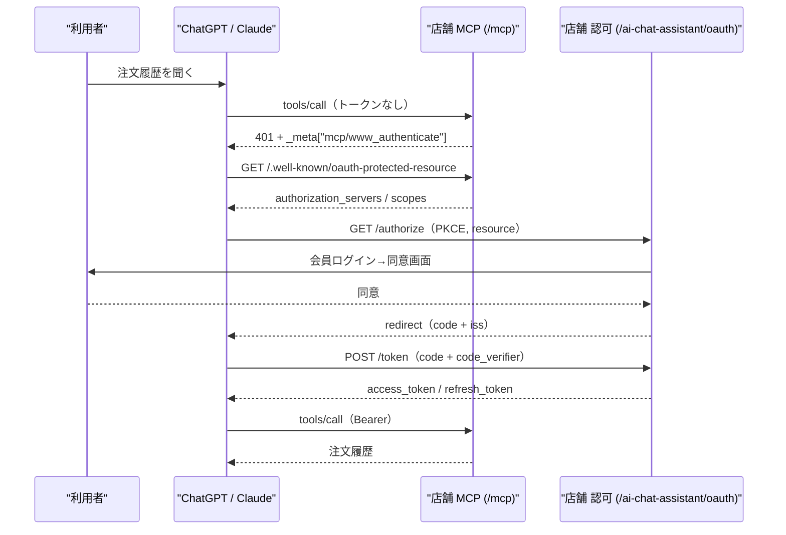

# MCP OAuth 実装設計（認可サーバーをプラグイン内に置く）

注文系ツール（会員固有の読み書き）を追加するための認可基盤。ChatGPT / Claude は「独自 API キー」を送れないため、会員の識別は OAuth 2.1 でしか実現できない。

- 前提: [ChatGPT プラグイン登録計画](CHATGPT_PLUGIN_PLAN.md) 第 7 章、[接続手順](CHATGPT_CONNECT.md)
- ステータス: **設計（本ドキュメント）とメタデータ宣言まで。認可エンドポイントは未実装**（ブラウザと DB が無い環境でセキュリティコードを書き上げないため、意図的に分割している）

---

## 1. 決定事項

| 項目 | 決定 | 理由 |
| --- | --- | --- |
| 認可サーバーの設置場所 | **各店舗の EC-CUBE（プラグイン内）** | 会員 ID は店舗 DB にしか存在しない。中央集約には会員情報の集約が必要になる |
| 同意画面 | EC-CUBE の会員ログインを再利用 | 新しい ID 体系を作らない。二重管理を避ける |
| 既存の公開ツール | 無認証のまま（`noauth`） | 商品カタログは店頭と同じ公開情報。auth を要求すると既存接続が壊れる |
| スコープ | `catalog.read` / `orders.read` / `orders.write` | 注文読み取りと書き込みを分け、段階導入できるようにする |
| クライアント登録 | CIMD 優先、DCR をフォールバック | OpenAI は CIMD を優先。DCR は Claude との互換に使う |

---

## 2. 全体像



---

## 3. エンドポイント

| Method | Path | 認可 | 応答 |
| --- | --- | --- | --- |
| GET | `/.well-known/oauth-protected-resource` | 公開 | `resource`, `authorization_servers`, `scopes_supported` |
| GET | `/.well-known/oauth-authorization-server` | 公開 | `issuer`, `authorization_endpoint`, `token_endpoint`, `registration_endpoint`（DCR）, `code_challenge_methods_supported: ["S256"]`, `client_id_metadata_document_supported` |
| GET | `/ai-chat-assistant/oauth/authorize` | 会員ログイン必須 | 同意画面（Twig）またはエラーリダイレクト |
| POST | `/ai-chat-assistant/oauth/authorize` | 会員ログイン + CSRF | `redirect_uri?code=...&state=...&iss=...` |
| POST | `/ai-chat-assistant/oauth/token` | クライアント認証（PKCE） | `access_token`, `token_type`, `expires_in`, `refresh_token`, `scope` |
| POST | `/ai-chat-assistant/oauth/register` | 公開（DCR） | `client_id`（CIMD 非対応クライアント用） |
| POST | `/ai-chat-assistant/oauth/revoke` | クライアント | 204 |

パスを `/ai-chat-assistant/` 下に置くのは、EC-CUBE 本体や他プラグインのルートと衝突しないため。メタデータだけは `.well-known` に固定。

---

## 4. データモデル

トークンは JWT ではなく **不透明文字列 + DB ハッシュ** にする。署名鍵の管理が不要で、失効が即時に効く。MCP クライアントは中身を読まないため不透明で十分。

```sql
CREATE TABLE plg_ai_chat_assistant_mcp_oauth (
  id BIGINT UNSIGNED AUTO_INCREMENT NOT NULL,
  code_hash CHAR(64) DEFAULT NULL,
  code_expires_at DATETIME DEFAULT NULL,
  code_used_at DATETIME DEFAULT NULL,
  access_hash CHAR(64) DEFAULT NULL,
  access_expires_at DATETIME DEFAULT NULL,
  refresh_hash CHAR(64) DEFAULT NULL,
  refresh_expires_at DATETIME DEFAULT NULL,
  client_id VARCHAR(255) NOT NULL,
  redirect_uri VARCHAR(255) NOT NULL,
  code_challenge VARCHAR(128) DEFAULT NULL,
  code_challenge_method VARCHAR(8) DEFAULT NULL,
  scopes VARCHAR(255) NOT NULL,
  customer_id INT DEFAULT NULL,
  resource VARCHAR(255) NOT NULL,
  revoked_at DATETIME DEFAULT NULL,
  created_at DATETIME NOT NULL,
  PRIMARY KEY(id),
  INDEX idx_mcp_oauth_code (code_hash),
  INDEX idx_mcp_oauth_access (access_hash),
  INDEX idx_mcp_oauth_refresh (refresh_hash)
) DEFAULT CHARACTER SET utf8mb4 COLLATE `utf8mb4_bin` ENGINE = InnoDB;
```

初期値（変更可能にする）:

| 項目 | 値 | 根拠 |
| --- | --- | --- |
| 認可コード寿命 | 60 秒 | 仕様上の推奨。単回使用 |
| アクセストークン寿命 | 60 分 | ChatGPT は期限切れで自動再認可する |
| リフレッシュトークン寿命 | 30 日 | 毎回の同意を避ける。使用時にローテーション |
| 1 店舗あたりの有効接続数 | 20 | 監査画面で失効できる前提 |

---

## 5. セキュリティ要件（実装時のチェックリスト）

1. `code_challenge_method` は `S256` のみ許可（`plain` は拒否）。
2. `redirect_uri` は登録済みクライアントの値と**完全一致**（前方一致・ワイルドカード禁止、`#` 禁止）。
3. 認可コードは **一回限り**。使用時に `code_used_at` を立て、同じコードの再交換は拒否して**発行済みトークンも失効させる**（再利用検知）。
4. `resource` パラメータをトークン行に保存し、`/mcp` 側で自分の URL と一致することを確認する（他店のトークンで叩けない）。
5. `client_id` は CIMD の場合は HTTPS URL を取得して `redirect_uris` を検証。取得結果はキャッシュ（TTL 1 時間）。
6. 同意画面の POST は CSRF トークン必須。会員ログインはセッションで判定。
7. 失敗時は `error` / `error_description` を返し、トークンや会員情報を含めない。
8. レート制限は `/token` と `/authorize` にも適用（既存 `RateLimitService` を拡張）。
9. 監査は既存 `McpAudit` に記録（トークン・会員 ID は保存しない。顧客 ID はハッシュ化）。
10. スコープは要求と発行の**積**のみ許可。未知のスコープは `invalid_scope`。

---

## 6. スコープとツールの割り当て

| ツール | 認可 | スコープ |
| --- | --- | --- |
| 既存 7 ツール（商品・在庫） | 無認証 | — （`_meta.securitySchemes: [{type: noauth}]` として宣言済み） |
| `get_my_orders` / `get_order_detail`（新規） | OAuth | `orders.read` |
| `add_to_cart`（新規） | OAuth | `orders.write` |
| `place_order`（新規） | OAuth | `orders.write` |
| `get_profile`（新規, `_meta["openai/profile"]: true`） | OAuth | `orders.read` |

宣言はツール単位（`_meta.securitySchemes`）。サーバー全体の既定値には依存しない。

---

## 7. 失敗時の応答

MCP のツール呼び出しで認可が必要な場合の形:

```json
{
  "jsonrpc": "2.0",
  "id": 4,
  "result": {
    "content": [{ "type": "text", "text": "Authentication required: no access token provided." }],
    "_meta": {
      "mcp/www_authenticate": [
        "Bearer resource_metadata=\"https://shop.example.com/.well-known/oauth-protected-resource\", error=\"insufficient_scope\", error_description=\"Login required\""
      ]
    },
    "isError": true
  }
}
```

HTTP レベルでは `401` + `WWW-Authenticate: Bearer resource_metadata="..."`。両方揃って初めて ChatGPT の接続 UI が出る。

---

## 8. 実装の分割（PR 単位）

| PR | 内容 | 受入条件 |
| --- | --- | --- |
| 1 | メタデータ 2 本 + `securitySchemes` 宣言 | `curl` で両文書が返る。既存 e2e が緑 |
| 2 | テーブル + リポジトリ + トークン発行 / 検証（純粋ロジック + Unit） | PKCE 検証・単回使用・期限・`resource` 一致の Unit が緑 |
| 3 | `/authorize`（GET/POST）+ 同意画面 + 会員ログイン誘導 | ブラウザで同意→コード発行まで通る（Docker） |
| 4 | `/token`（code 交換・refresh・revoke）+ CIMD/DCR | curl でコード交換、MCP Inspector で接続 |
| 5 | ツール実装（履歴→カート→注文）と `securitySchemes` 更新 | 実機 ChatGPT で履歴照会、次にカート投入 |

各 PR は **Docker の実機確認を必須**とする。認可コード・PKCE・単回使用は Unit だけでは不十分。

---

## 9. テスト計画

- Unit: PKCE `S256` 検証、期限切れ、単回使用の再利用検知、`resource` 不一致、未知スコープ、redirect_uri 完全一致。
- e2e（Playwright, Docker）: `/authorize` 未ログイン → ログイン誘導、同意 → コード、`/token` → アクセストークン、`/mcp` に Bearer で `tools/list`。
- 手動: MCP Inspector の Auth 設定でフローを通す。実機 ChatGPT（Pro）で接続。
- 異常系: `code_verifier` 不一致、コード再利用、期限切れコード、他店の `resource`。

---

## 10. 未決事項

1. **ログイン誘導の戻り先**: EC-CUBE の `mypage_login` に `return_url` を渡せるか。渡せない場合は「ログイン後にこのページを開き直す」案内を出す（Docker で確認）。
2. **同意画面の表示項目**: 店舗名・要求スコープ・接続元（ChatGPT / Claude）を出す想定。文言は法務確認。
3. **失効 UI**: 管理画面に「接続中のアプリ」一覧を出すか（推奨: 出す）。
4. **複数店舗での共通化**: 各店舗が独自 AS を持つため、CIMD の取得先（chatgpt.com）への外向き通信が必要。WAF で塞がれる店舗向けに DCR フォールバックを残す。
